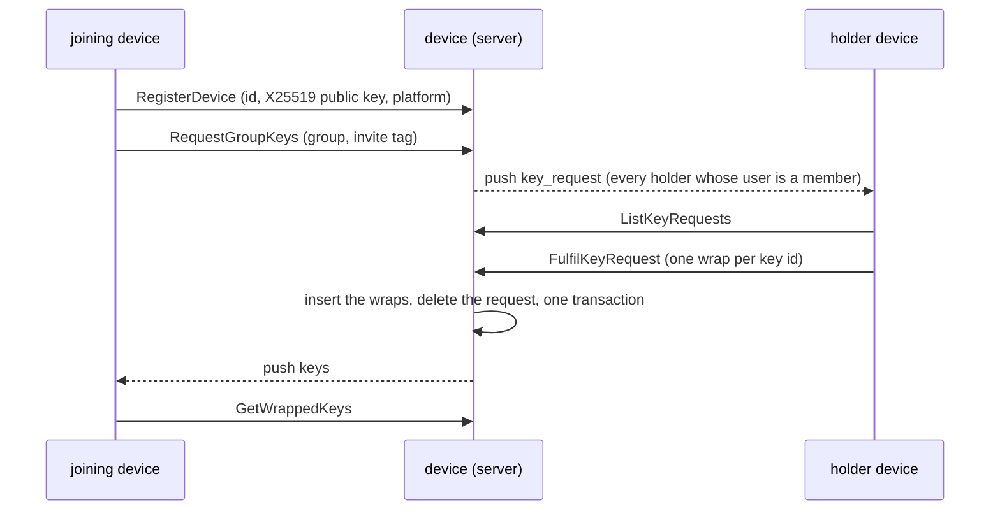

# device flows

A plain executor: no lifecycle of its own. What it keeps is who holds
which group key (`wrapped_key`), who is asking (`key_request`), and how to
wake each device (`device.push_*`). Membership is `group`'s to answer and
is asked through `CheckMembershipRequest` wherever a rule reads it.

## The key exchange, server side

Who may fulfil: a device that holds a key for the group, whose user is an
admin or member, or the requesting device's own user whatever their role
(`approver_allowed`). A viewer approves nothing but its own devices. The
server verifies no tag and no fingerprint: that is the person's tap on the
holder's device (`docs/01-deappje/02-device.md`, the three ways).

## Publishing a key (`PublishWrappedKeys`)

The first key of a group (the creator's device, for itself), a rotation
(`key_id` n+1 for every holder of n), a subgroup's key for the parent's
holders: all one handler, with these rules in order.

1. The publishing device is the caller's and its user a member.
2. A rotation (`key_id > 1`) is published by a holder of the previous key.
3. One publisher per key id (`publisher_allowed`): rows from another device
   under the same id refuse the batch, the loser re-reads and adopts.
4. A wrap lands for a device that is registered, whose user is a member,
   and, for a rotation, that holds the previous key; the rest of the batch
   is dropped and the answer shows what landed.
5. `ON CONFLICT DO NOTHING` on the unique `(group_id, key_id, device_id)`,
   so the same publisher's repeat lands nothing twice.

## Wake-ups (`push.rs`)

| Event | Who is woken | Reason |
|---|---|---|
| `RequestGroupKeys` | every holder device whose user is a member | `key_request` |
| `FulfilKeyRequest` | the requesting device | `keys` |
| `GroupHeadAdvanced` (from `relay`) | every holder device but the writer's, whose user is a member | `head` |
| `MemberRemoved` (from `group`) | the remaining holder devices | `rotate` |
| `HistoryRequested` (from `relay`) | the devices `relay` listed, the requester excluded | `history` |
| `HistoryReady` (from `relay`) | the requester device | `history_ready` |

A push is dispatched `Unfenced` through the one adapter of the device's
provider. A token the provider reports dead (APNs 410 or `BadDeviceToken`,
FCM `UNREGISTERED`) is forgotten; any other failure is logged and dropped,
the client polls heads on foreground anyway.

## Losing keys

| Trigger | What goes | `DeviceLeftGroup` to `relay` |
|---|---|---|
| `MemberRemoved` | the user's wraps and requests in that group | every device of the user, keys or not (relay may hold a row for a device that acked before its keys came) |
| `RemoveDevice` | the device's wraps, requests and row | per group the device held a key for |
| `PurgeUserDevices` | every device of the user with its wraps and requests | per (group held, device) |
| `PurgeGroupKeys` | every wrap and request of the group | none: the group is gone, `relay` purges its own |

## Edge cases

| # | Trigger | Code path | Behaviour |
|---|---|---|---|
| 1 | Registering an id under another user | `handle_register_device_request` | `PermissionDenied`; the id is the first registrant's |
| 2 | Registering a known id with a new key | same | `FailedPrecondition`: a device's key never changes; remove and register anew |
| 3 | A second request from the same device | `handle_request_group_keys_request` | The open one is returned; the unique `(group_id, device_id)` makes a race land one |
| 4 | A request from a device that already holds keys | same | `FailedPrecondition` |
| 5 | The requesting device was removed before fulfilment | `handle_fulfil_key_request_request` | The request is deleted, `NotFound` |
| 6 | The requester's user lost membership before fulfilment | same | The request is deleted, `FailedPrecondition` |
| 7 | Two devices rotate at once | `handle_publish_wrapped_keys_request` | The first batch's publisher owns the key id; the second is refused and adopts |
| 8 | A holder whose user lost membership (rows not yet dropped) | `member_holders` | Not woken: membership is asked per user before every group-wide wake |
| 9 | A device with no push token | `wake` | Not woken; it syncs when opened |
| 10 | Neither push service configured | `Providers` | Every send refused definitively, logged and dropped; a deploy does not wait for the secrets (`k8s/app/deployment.yaml`) |
| 11 | A second `MemberRemoved` for the same user | `handle_member_removed` | Nothing to delete; relay is told again, the holders asked to rotate again, all idempotent |
