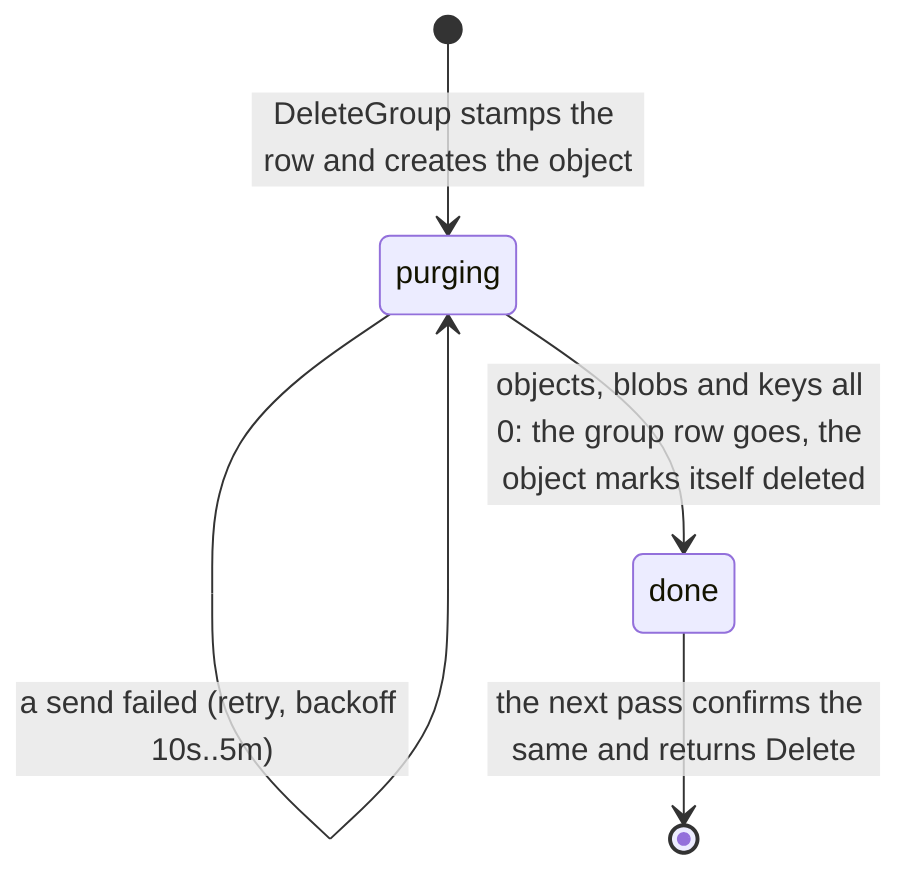

# group flows

## Membership rules, in one place

Every change to a group's memberships is one transaction that locks the
group row first (`repository::lock_group`), so the counts the rules read
are what commits:

- the creator is the first admin, inserted with the group;
- a subgroup is made by a member of its parent, one level deep for now,
  and admits members of the parent only (checked on accept and on
  `AddMember`);
- an invite hands out `member` or `viewer`, never `admin`; `SetMemberRole`
  grants that;
- a user is in a group at most once (the unique index; an accept by a
  member is a no-op that consumes no use);
- a removal or leave in a parent cascades to its subgroups in the same
  transaction, one `MemberRemoved` per group, sent after the commit;
- the last admin cannot leave or be demoted while other members remain;
- the last member cannot leave: they delete the group instead (an empty
  group would be unreachable forever);
- an account being deleted makes no call but `CheckMembership`, which
  answers truthfully until its memberships are gone.

A group stamped `deleted_at` answers no membership from that commit on,
whatever rows still hang off it; the rows go with the purge.

## `group_purge` lifecycle

Created by `DeleteGroup` (one per group and per subgroup, the subgroup's
pointing at the parent's as `parent_purge_id`), by `user_purge` for a
group the user was alone in, and adopted on a retry (its id is
`UUIDv5(group_id, "group_purge")`). The order of a deletion is fixed by
what a crash between two commits must leave behind (`src/purge.rs`):
stamp the row, then create the object, then delete the rows.

Every pass, level-triggered: empty the group's own rows (idempotent);
count the purges that name this one as parent and wait while any exists;
send `PurgeGroupObjectsRequest` to `relay`, `PurgeGroupBlobsRequest` to
`storage` and `PurgeGroupKeysRequest` to `device`, each answering what it
still holds; all three zero means the row goes and the object marks
itself deleted, which leaves the completion due at once; the deleting
pass re-drives the same checks and returns `Delete` on the same answer.

## `user_purge` lifecycle

Created by `DeleteAccount` (id `UUIDv5(user_id, "user_purge")`, adopted
on a repeat).

```mermaid
stateDiagram-v2
    [*] --> leaving: DeleteAccount
    leaving --> leaving: a membership left: give up one group, the deepest first (requeue now)
    leaving --> devices: none left
    devices --> devices: device still holds some (wait 30s)
    devices --> identity: PurgeUserDevicesRequest answers 0
    identity --> identity: the identity exists: delete_identity under the claim, confirm next pass
    identity --> done: the lookup finds it absent
    done --> [*]: marked deleted; the next pass confirms and returns Delete
```

Giving up one group (`Group::leave_one_group`): the only member means the
group goes with them (stamp, purge object, rows; its subgroups too, their
members being a subset); the only admin means the longest-standing
member, else viewer, inherits the role; otherwise the membership is
deleted, cascading to subgroups, and `MemberRemoved` sent per group. A
group already stamped has its purge ensured and this user's rows dropped.

## Edge cases

| # | Trigger | Code path | Behaviour |
|---|---|---|---|
| 1 | Two accepts of a one-use invite at once | `handle_accept_invite_request` | The group lock, then the invite lock, serialize them: one admitted, the other `FailedPrecondition: invite used up`, `uses` 1 |
| 2 | A member accepts again | same | The existing membership, no use consumed, whatever the invite's state |
| 3 | `DeleteGroup` retried after the purge object failed to be created | `handle_delete_group_request` | The admin's row is still there, so the retry is authorised; the object is created or adopted by id |
| 4 | `DeleteGroup` retried after the rows went | same | `PermissionDenied`: the group is gone to its former admin, as to everyone |
| 5 | A subgroup deleted on its own while the parent is deleted later | `ensure_group_purges` | The parent's handler adopts the subgroup's existing purge (no parent pointer), so the parent does not wait for it; both finish on their own |
| 6 | A purge request's answer is lost | `group_purge` pass | `Retry`; the next pass asks every receiver again, each idempotent |
| 7 | The group row went before the object was marked (crash after `delete_group`) | `group_purge` deleting pass | `empty_group` finds no row, the receivers answer 0 again, `Delete` |
| 8 | The account purge meets a group already stamped | `leave_one_group` | Ensures the purge object, drops the user's rows there, moves on |
| 9 | `delete_identity` acked but the next lookup still finds the identity | `user_purge` pass | Sent again (idempotent; a 404 is success); the audit pins the re-send |
| 10 | No `KRATOS_ADMIN_URL` (local dev) | `NoopProvider` | The lookup errors, the pass retries with backoff: an account purge waits at `identity` until Kratos is reachable |
| 11 | The last admin wants out of a group with members | `handle_leave_group_request`, `handle_set_member_role_request` | `FailedPrecondition`; promote someone first |
| 12 | A viewer calls `AddMember` on a subgroup | `handle_add_member_request` | `PermissionDenied`: adding is writing |
