# relay flows

A plain executor with two hourly sweeps. Member devices are the store; the
server keeps, per group, the rows some device has not acked yet, 672 hours
at most (`WINDOW`), tombstones included, and forgets everything after.
Every write to a group's log and every move of its floor runs under the
group's counter row locked `FOR UPDATE` (`repository::lock_head`): a seq
is handed out and committed in one transaction, so no reader ever sees a
higher seq commit before a lower one.

## A push (`PushObjects`)

```mermaid
sequenceDiagram
    participant D as device
    participant R as relay
    participant G as group
    participant V as device (nanoservice)
    participant S as storage
    D->>R: PushObjects (group, objects with base_seq)
    R->>G: CheckMembership: admin or member
    R->>R: lock group_head; holder? (ack >= floor) else behind_floor
    R->>R: per object: no row or base == seq: write at head+1; else conflict with the current row
    R->>R: commit
    R-->>V: GroupHeadAdvanced (head, writer device)
    R-->>S: ObjectDeleted per tombstone
    R-->>D: accepted (id, seq), conflicts (id, current), head
```

The compare-and-set (`handlers::cas`): no row, or `base_seq` equal to the
row's seq, accepts and takes the next seq; anything else answers the
current row, tombstone or not. The holder check (`handlers::is_holder`)
refuses the whole batch when the device has no row or its ack is below the
eviction floor: a device that has not seen everything the server evicted
cannot be trusted with an empty slot, `base_seq = 0` included.

## Pull, ack, heads

- `PullChanges` pages rows with `seq > since_seq`, oldest first, with the
  head, the floor, the lowest ack among the group's devices and `more`.
- `AckSeq` (`handlers::ack_allowed`): a device's first act in a group is 0,
  which creates its row; acks are monotone, never above the head; 0 again
  starts over. The row's ack pins the group's minimum, so nothing it has
  not acked is evicted by ack from under it.
- `GetHeads` answers the groups the caller is a member of among those
  asked; one left out is one the caller is no longer in.

## History (`RequestHistory`, `ListHistoryRequests`, `ClaimHistory`, `PushHistory`)

```mermaid
stateDiagram-v2
    [*] --> unfillable: no other device at or above the floor (nothing stored)
    [*] --> open: a row, HistoryRequested to the holders
    open --> claimed: ClaimHistory by a holder (first wins; the rest: taken)
    claimed --> open: 5 minutes without complete (abandoned: claimable again)
    claimed --> claimed: PushHistory, oldest first, rows re-inserted at their original seqs; HistoryReady to the requester
    claimed --> [*]: PushHistory complete (the row goes)
    open --> [*]: 672 hours (expire_history_requests)
    claimed --> [*]: 672 hours
```



A re-inserted row keeps its seq and gets a fresh `uploaded_at`; an id that
already has a row, at any seq, live or tombstone, is skipped: the current
row always wins. Neither the head nor the floor moves.

## Sweeps

- `evict_objects`, by ack: per group, rows at or below the lowest ack go
  and the floor follows it. By age: rows uploaded before `now - 672h` go,
  batched, each group's floor follows the highest seq taken, and the
  group's devices below the new floor that have not acked within the
  window lose their row (they start over when they are back). A device
  catching up (a recent ack below the floor) keeps its row.
- `expire_history_requests`: rows older than the window go.

## Edge cases

| # | Trigger | Code path | Behaviour |
|---|---|---|---|
| 1 | A push from a device with no row, or below the floor | `handle_push_objects_request` | `BehindFloor { evicted_through_seq }`, whatever the batch holds; the device starts over (ack 0, pull, history) |
| 2 | A viewer pushes | same | `PermissionDenied`; a viewer pulls, acks and answers history |
| 3 | A value over 1 MiB, an empty value, a live object without one, an id twice | same | `InvalidArgument` for the whole batch |
| 4 | An id that belongs to another group | same | `FailedPrecondition` for the batch: ids are the client's, and never shared |
| 5 | A delete over a stale base | same | A conflict carrying the current row, like any edit |
| 6 | A live push from the tombstone's seq | same | Accepted: an un-delete is the client's decision |
| 7 | Two replicas push to one group at once | `lock_head` | Serialized on the counter row: a gap-free sequence |
| 8 | A first ack above 0, a backwards ack, an ack above the head | `handle_ack_seq_request` | `FailedPrecondition` |
| 9 | A history request in a group with no other holder | `handle_request_history_request` | `unfillable`, nil id, nothing stored, nobody woken |
| 10 | The requester claims its own request | `handle_claim_history_request` | `InvalidArgument` |
| 11 | A claim by a device below the floor | same | `PermissionDenied` |
| 12 | A claimer that stops | `claimable_requests`, `claim_request` | Listed and claimable again after five minutes; the first claimer's later push is refused |
| 13 | A history push out of order, outside the range, for another object, above the head | `handle_push_history_request` | `InvalidArgument`; nothing landed |
| 14 | A history push for a request that was completed or expired | same | `NotFound` |
| 15 | Eviction by age while a device is catching up | `evict_by_age` | The device's row stays while its ack is recent; it loses it after a window without acks |
| 16 | A purge of a group with many rows | `handle_purge_group_objects_request` | Ten thousand rows per call, the counter and the devices with the last batch; `remaining` says what is left |
