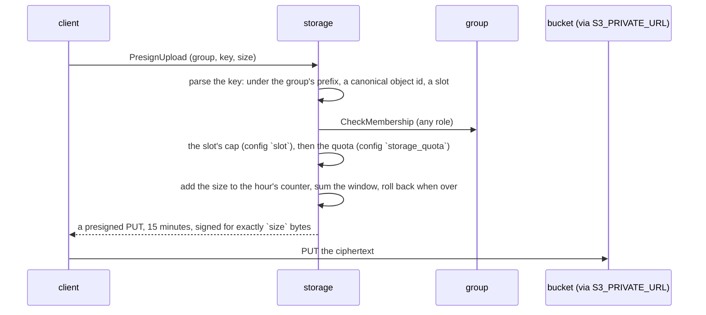

# storage flows

A plain executor with one hourly sweep. No table of blobs: a file's
reference lives inside the encrypted value of the object that owns it, the
key is derived (`g/<group_id>/o/<object_id>/<slot>`), and the bucket's own
lifecycle rule expires what is old. The one table counts declared upload
bytes per group per hour, for the quota.

## An upload (`PresignUpload`)

The hour row's lock serializes concurrent presigns of one group within the
hour; an upload that would cross the cap is rolled back out of the
counter, so a refusal leaves no trace. The PUT's signature covers
`content-length`, so a client cannot declare one size and send another.

A download is the same check on the key and the member, then a presigned
GET for five minutes. An expired file is the bucket's 404; the client asks
`relay` for the object, whose holders re-upload to the same key.

## Deleting files

- `ObjectDeleted` (from `relay`, per tombstone): list the object's prefix,
  delete each key, `Unfenced`; most objects have no files and the listing
  is empty. A delete that fails is logged; the next tombstone for the same
  object retries (a deleting client re-sends its batch until accepted).
- `PurgeGroupBlobs` (from `group`'s purge pass): list the group's prefix
  (a thousand keys), delete each, list again and answer what is still
  there; the pass calls again until zero.

## Sweep

`expire_usage`, hourly: counters older than 168 hours stop counting.

## Edge cases

| # | Trigger | Code path | Behaviour |
|---|---|---|---|
| 1 | A key outside the caller's group prefix | `parse_key` | `PermissionDenied`, before any other check |
| 2 | A key of another shape: a missing segment, an empty one, `..`, an object id not in canonical form, a slot with other characters | `parse_key` | `InvalidArgument`; nothing of that shape ever reaches the bucket, so the gateway's path normalisation never meets a signed path |
| 3 | A slot the catalog does not know | `handle_presign_upload_request` | `InvalidArgument` |
| 4 | A size over the slot's cap | same | `InvalidArgument`, before the quota is touched |
| 5 | A size that would cross the group's quota | same | `ResourceExhausted`; the counter is rolled back |
| 6 | Two presigns of one group at once | `add_usage` | The hour row's lock serializes them: the sum is exact |
| 7 | No `object-storage` Secret | `Unconfigured` | Presigning answers `Unavailable`; deletes are refused definitively and logged |
| 8 | A refused delete during a purge | `handle_purge_group_blobs_request` | The key still shows in the listing after: `remaining` counts it, the next call retries |
| 9 | A tombstone for an object with no files | `handle_object_deleted` | One empty listing, nothing else |
